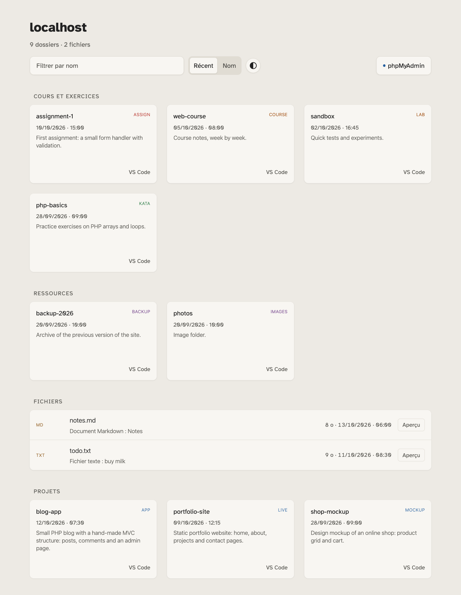
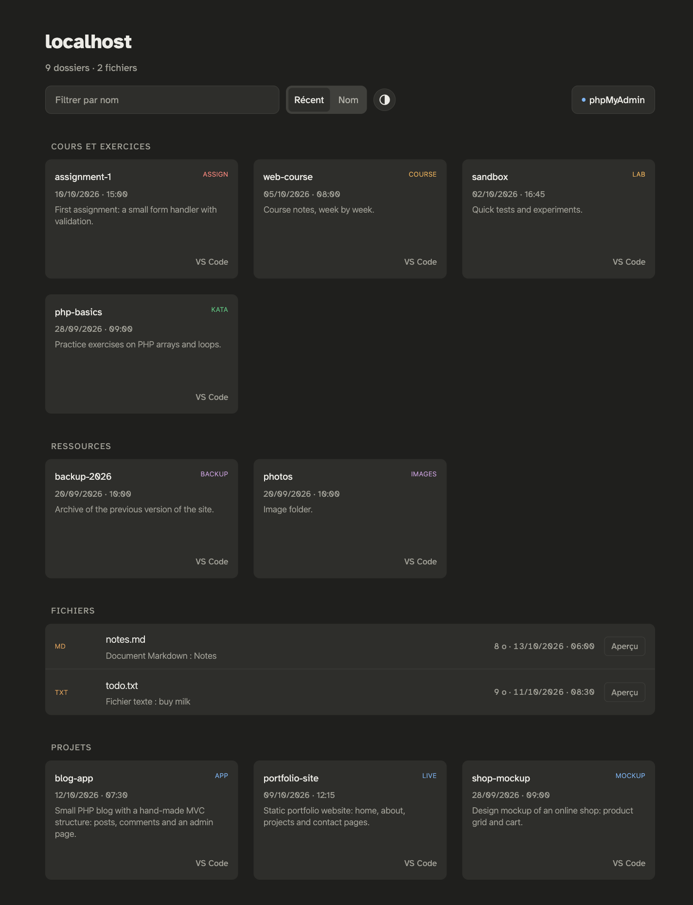

# htdocs launcher

English below · [Version française plus bas](#version-française)

A local homepage for a XAMPP (or similar) web root: project cards with date and nature tag, folder listings with file descriptions, a file preview page, light and dark themes. Interface in French.

 

> **Local use only.** This launcher has no login. Run it on `localhost` (listen on `127.0.0.1` only) and never expose it to the Internet or an untrusted network. It lists your folders and previews your files, and the refusal of sensitive files works from a list of names (`config/`, `db.php`, `.env`, dotfiles, a few extensions): a secret kept in a file with another name can be previewed. It follows symbolic links, and the first-page images of Office documents use a macOS tool (up to 20 s per document), so an exposed copy could be slowed down by anyone.

### Install

1. Copy `index.php`, `_listing.php`, `_preview.php`, `_site/` and (Apache only) `.htaccess` into the root of your htdocs.
2. Open `http://localhost/`. Each folder of your htdocs becomes a card.

Requires PHP 8.0 or later. `.htaccess` is ignored by nginx (Herd): block sensitive files (`.git`, `.env`, `.sql`, `config/`) in your own server config.

### Make it yours

- `_site/lib/descriptions.php`: `DESCRIPTIONS` (short text per folder) and `EXTERNAL_LINKS` (extra link on a card). Both ship empty.
- `_site/lib/kind.php`: `KIND_OVERRIDES` forces a folder's nature. A `.tag` file in a folder does the same.
- `.local` links are read from `/Applications/XAMPP/xamppfiles/etc/extra/httpd-vhosts.conf` (read-only). If the file is missing, no links are shown (change `VHOSTS_CONF` in `_site/lib/vhosts.php`).
- PDF export of Office files (`_site/export/`) is macOS only and runs from Terminal.

Contents of config files, `db.php`, PHP files and dotfiles are never read or previewed, because they can hold passwords.

Atkinson Hyperlegible font: SIL Open Font License, see `_site/fonts/README.txt`.

## License

MIT, see [LICENSE](LICENSE). The font keeps its own license (above).

---

## Version française

Une page d'accueil locale pour la racine web d'un XAMPP (ou équivalent) : cartes de projets avec date et étiquette de nature, listings de dossiers avec description de chaque fichier, page d'aperçu des fichiers, thèmes clair et sombre. Interface en français.

 

> **Usage local uniquement.** Ce lanceur n'a pas de connexion. Utilise-le sur `localhost` (écoute sur `127.0.0.1` seulement) et ne l'expose jamais sur Internet ni sur un réseau qui n'est pas le tien. Il liste tes dossiers et affiche tes fichiers, et le refus des fichiers sensibles repose sur une liste de noms (`config/`, `db.php`, `.env`, fichiers cachés, quelques extensions) : un secret rangé dans un fichier d'un autre nom peut être affiché. Il suit les liens symboliques, et les images de première page des documents Office utilisent un outil macOS (jusqu'à 20 s par document) : une copie exposée pourrait être ralentie par n'importe qui.

### Installation

1. Copie `index.php`, `_listing.php`, `_preview.php`, `_site/` et (Apache seulement) `.htaccess` à la racine de ton htdocs.
2. Ouvre `http://localhost/`. Chaque dossier de ton htdocs devient une carte.

Il faut PHP 8.0 ou plus récent. `.htaccess` est ignoré par nginx (Herd) : bloque les fichiers sensibles (`.git`, `.env`, `.sql`, `config/`) dans la configuration de ton propre serveur.

### Personnalisation

- `_site/lib/descriptions.php` : `DESCRIPTIONS` (court texte par dossier) et `EXTERNAL_LINKS` (lien supplémentaire sur une carte). Les deux sont vides au départ.
- `_site/lib/kind.php` : `KIND_OVERRIDES` impose la nature d'un dossier. Un fichier `.tag` dans un dossier fait la même chose.
- Les liens `.local` sont lus (en lecture seule) dans `/Applications/XAMPP/xamppfiles/etc/extra/httpd-vhosts.conf`. Si le fichier est absent, aucun lien n'est affiché (change `VHOSTS_CONF` dans `_site/lib/vhosts.php`).
- L'export en PDF des fichiers Office (`_site/export/`) ne fonctionne que sur macOS, et se lance depuis le Terminal.

Le contenu des fichiers de configuration, de `db.php`, des fichiers PHP et des fichiers cachés (dont le nom commence par un point) n'est jamais lu ni affiché en aperçu, parce qu'ils peuvent contenir des mots de passe.

Police Atkinson Hyperlegible : licence SIL Open Font License, voir `_site/fonts/README.txt`.

### Licence

MIT, voir [LICENSE](LICENSE). La police garde sa propre licence (ci-dessus).
